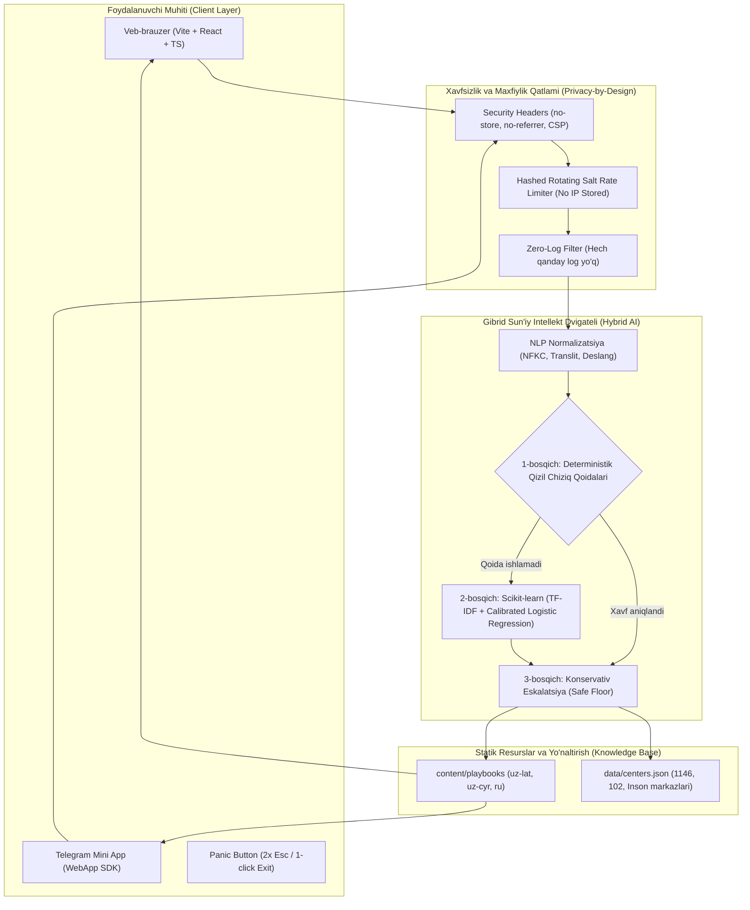

# HimoyaAI — Tizim Arxitekturasi (Architecture Document)

> «Raqamli avlod qizlari» respublika tanlovi (Yo‘nalish: Sun’iy intellekt) uchun ishlab chiqilgan.

---

## 1. Umumiy Arxitektura Diagrammasi

---

## 2. Nega Aynan TF-IDF + Logistic Regression? (Texnik Asoslash)

Hakamlar hay'ati savol berishi mumkin: *"Nega og'ir LLM (OpenAI, Gemini yoki LLaMA) ishlatilmadi?"*

1. **Mutlaq Maxfiylik (Data Sovereignty & No-Log):**
   Zo'ravonlikka uchragan ayolning eng maxfiy murojaatini tashqi xorijiy API (OpenAI / Anthropic) ga yuborish jiddiy maxfiylik va qonuniy xavf tug'diradi. Bizning model 100% lokal server xotirasida (RAM) ishlaydi va foydalanuvchi matni server chegarasidan tashqariga chiqmaydi.
2. **Millisekundlik Tezlik (Latency < 20 ms):**
   LLMlar 2–5 soniya kutish vaqtini talab qiladi. Bizning yengil TF-IDF + Calibrated LR modelimiz p95 < 20 ms tezlikda ishlaydi, bu hatto 2G/3G sekin mobil internetda ham bir zumda javob berishni ta'minlaydi.
3. **Deterministik Ishonchlilik va "Gallyutsinatsiyalarga" Yo'l Qo'ymaslik:**
   Krizis holatida AI "o'zidan to'qib" maslahat berishi inson hayoti uchun xavflidir. Bizning tizimda xavf toifasi aniqlangach, unga beriladigan ko'rsatma O'zbekiston qonunchiligi va psixologlar tomonidan oldindan tasdiqlangan `content/playbooks` orqali taqdim etiladi.
4. **Resurs Tejamkorligi:**
   Model hajmi < 15 MB bo'lib, eng arzon serverlarda yoki hatto chekka hududlardagi kompyuterlarda ham GPU'siz ishlay oladi.

---

## 3. Gibrid Qaror Tizimi (Hybrid Decision Making)

Tizim faqat mashinaviy o'qitishga tayanib qolmaydi:
- **1-bosqich (Qizil qoidalar):** Agar matnda pichoq, qurol, o'ldiraman, bo'g'ish, bolaga nisbatan tajovuz yoki o'z joniga qasd qilish belgilari bo'lsa — model hisob-kitobidan qat'i nazar darhol **Qizil xavf** beriladi.
- **2-bosqich (Kalibrlangan ML):** Word n-gram (1-2) va Character n-gram (2-5) orqali imlo xatolariga chidamli vektorlar tuziladi va ehtimolliklar olinadi.
- **3-bosqich (Xavfsizlik eskalatsiyasi):** Agar noaniqlik bo'lsa yoki Qizil ehtimol >= 25% bo'lsa, xavfsizlik nuqtai nazaridan daraja bir pog'ona yuqoriga ko'tariladi.
